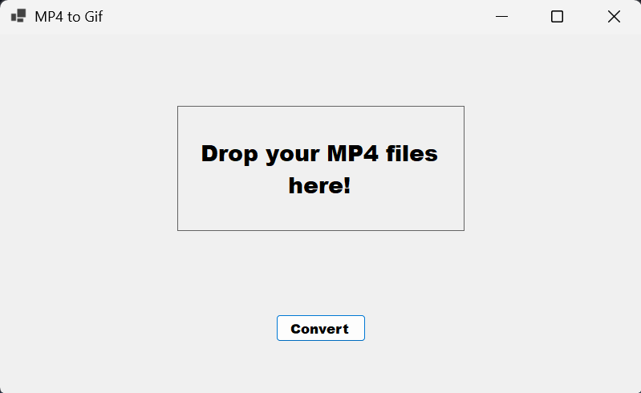

# MP4 to Gif Converter

  

Simple app I made using C# to convert my mp4 videos into gifs.
To use just open the app and install the required package and its good to go.

Uses [FFmpeg](https://ffmpeg.org/) to process and encode the videos / gifs.

I used [this](https://github.com/rosenbjerg/FFMpegCore) library to download ffmpeg on launch.